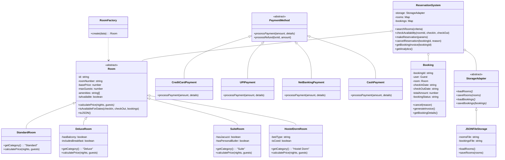

# 🏨 Grand Horizon Hotel & Hostel Reservation System

An enterprise-grade, Object-Oriented Hotel & Hostel Reservation Engine built with **JavaScript / Node.js**, featuring persistent **File I/O**, a comprehensive **CLI test harness**, and a **luxury responsive web dashboard**.

---

## 🌟 Key Features

1. **Room & Dorm Categorization (OOP Subclasses)**
   - **Standard Room**: Queen/Twin beds, standard amenities, standard cleaning fees.
   - **Deluxe Room**: King bed, scenic balcony, minibar, and complimentary breakfast.
   - **VIP Suite**: Living room, hydrotherapy jacuzzi, and 24/7 dedicated butler service.
   - **Hostel Dorm Bed**: Pod/bunk bed allocation, digital security lockers, communal lounge, and 10% multi-night backpacker discounts.
2. **Search & Availability Engine**
   - Filter by check-in / check-out dates, guest capacity, price range, and keywords.
   - Collision detection preventing double-booking across overlapping calendar dates.
3. **Multi-Method Payment Simulation**
   - **Credit / Debit Cards**: Card number validation, CVV check, masking, and authorization codes.
   - **UPI (Unified Payments Interface)**: Instant VPA verification (`user@bank`, Google Pay, PhonePe, Paytm).
   - **Net Banking**: Bank gateway simulation.
   - **Pay at Front Desk / Cash**: Reserve now, pay upon arrival.
4. **Booking Lifecycle & Tiered Cancellation Refund Policy**
   - Instant booking confirmation & official printable receipt/invoice generation.
   - Dynamic refund calculation:
     - **> 48 hours** before check-in: **100% full refund**.
     - **24 to 48 hours** before check-in: **70% refund**.
     - **< 24 hours** before check-in: **25% refund**.
     - Date freeing: Rooms automatically become available again upon cancellation.
5. **Persistent File I/O & LocalStorage**
   - Persistent storage to JSON files (`data/rooms.json`, `data/bookings.json`, `data/transactions.json`).
   - Browser client supports persistent `localStorage` and JSON database Export / Import.

---

## 🏗️ Object-Oriented Architecture (OOP)



### Design Patterns Used
- **Factory Pattern (`RoomFactory`)**: Instantiates the proper polymorphic subclass based on category metadata.
- **Strategy Pattern (`PaymentProcessor` & `PaymentMethod`)**: Interchangeable payment providers (Card, UPI, NetBanking, Cash).
- **Facade Pattern (`ReservationSystem`)**: Unifies inventory management, date collision checking, payment handling, and persistence.
- **Adapter Pattern (`StorageAdapter`)**: Decouples persistence mechanisms, enabling swapping between JSON file systems and databases.

---

## 📁 Project Directory Structure

```
Hotel Reservation System.js/
├── data/
│   ├── rooms.json             # Persistent room & dorm inventory database
│   ├── bookings.json          # Persistent reservation records
│   └── transactions.json      # Audit logs for payments & refunds
├── src/
│   ├── models/
│   │   ├── Room.js            # Base Room & Standard, Deluxe, Suite, HostelDorm models
│   │   ├── User.js            # User, Guest, Admin models
│   │   ├── Booking.js         # Booking state machine, invoice & refund logic
│   │   └── Payment.js         # Payment strategies (Card, UPI, NetBanking, Cash)
│   ├── storage/
│   │   └── FileStorage.js     # StorageAdapter and JSONFileStorage engine
│   └── services/
│       └── ReservationSystem.js # Core orchestrator and business logic
├── index.js                   # Node.js entry point (automated test suite & interactive CLI)
├── index.html                 # Interactive Web application dashboard
├── styles.css                 # Modern CSS design system
├── app.js                     # Frontend OOP application client
├── package.json               # NPM configuration
└── README.md                  # Project documentation
```

---

## 🚀 How to Run

### Option 1: Run the Interactive Web GUI (In Browser)
Simply double-click or open `index.html` in your favorite web browser (Chrome, Edge, Firefox, Safari).
- Filter and search rooms in real time.
- Open the booking modal and simulate payment with live credit card preview or UPI.
- View official luxury printable invoices.
- Cancel bookings to test automated tiered refunds.
- Export/Import JSON database files.

### Option 2: Run in Node.js (CLI Automated Verification Suite)
Open a terminal in this directory and execute:

```bash
node index.js
```

This runs an automated end-to-end verification demonstrating:
1. Room catalog loading across all 4 categories.
2. Searching rooms with filters.
3. Booking a Presidential Suite with simulated Credit Card payment.
4. Overlap collision testing (attempting double-booking).
5. Booking a Hostel Dorm Bed with UPI payment and backpacker discounts.
6. Generating and printing the official invoice.
7. Canceling a booking with automated refund calculation.
8. Verifying room availability is restored.
9. Database reload from JSON files to prove File I/O persistence.
10. Financial & occupancy analytics.

### Option 3: Run Interactive Node.js Console Menu
```bash
node index.js --interactive
```
Provides an interactive numeric CLI menu allowing you to search, book, view invoices, cancel, and check analytics directly from the terminal.
